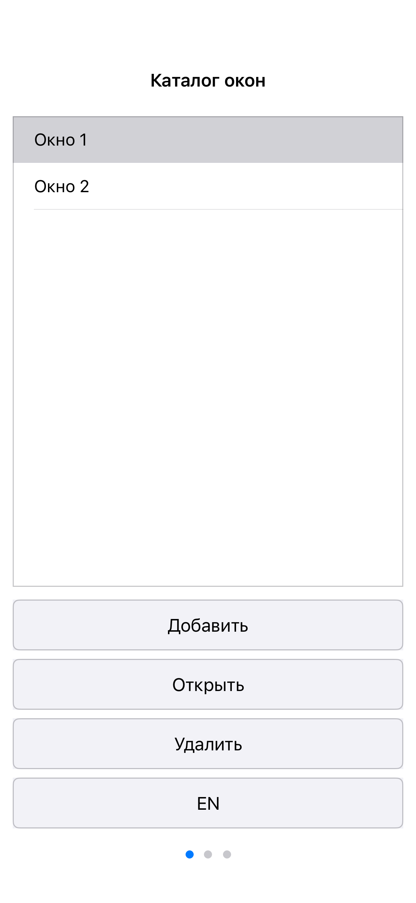
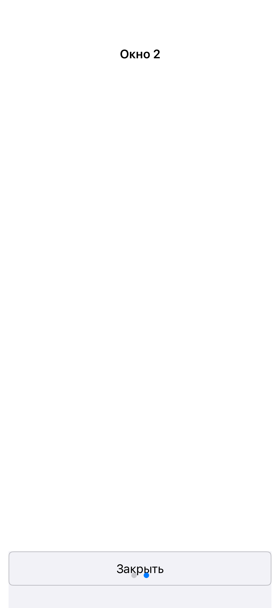

# iOS WindowCatalog — 2026-11-10

User-authorized iPhone port on the isolated `feature/apple-window-catalog`
branch, alongside the macOS click correction. Baseline: `b0c808d`. Parallel
Windows/Linux/Web/Android/headless work remains on its original branch.

## Architecture and behavior

The iOS application composes the shared WindowCatalog C++20 model, graph,
Events, model runtime, publication/mirror and RAM BACKING/USER storage. It uses
two thin catalog presenters over the generic iOS backend. SwiftUI renders
published model rectangles; UIKit supplies the native table and page control.
Button, selection, page and swipe intents go through ModelObjectProxy/Events.
No application copy of the runtime/mirror and no persistent mirror mutation.

Add creates and activates a page. Open or native row double-tap opens/activates
the selected holder; Delete removes it. Swipes/page control use the model's
mobile ring. The graph supplies localized Close controls. Close selects the
model ring predecessor, which may be another child. The model keeps selection
and active page distinct. RU/EN updates all pages, including lazy/closed pages
when reopened.

The common application model gained an S0 child-client-viewport Event. Its
Apply computes the mobile Close rectangle from the current viewport/DPI with
12dp margins and 48dp height. Same-size density changes update loaded mobile
layouts. Closed/lazy/removed queued targets are skipped without materializing
them. This is a separate model commit; desktop layout and persistent schema
fields are unchanged. The iOS composition reports safe-area logical points
at density 160 through these model intents.

Native table callbacks resolve the identity of their displayed row against the
current adapter before sending a command. Detached callbacks are disconnected.
A queued second Close checks live domain membership before invoking a target
that the first Close may already have unloaded. These checks concern legitimate
native lifetime transitions; graph links remain direct required contracts.

## Session and build boundaries

Normal Debug distills a fresh graph once per process. Background ends the
session: drain accepted commands, save to RAM USER, write one `user.bin`, join
the runtime and release the UI session. Foreground creates a new bridge/runtime
over the same application-owned RAM profile. It does not create a continuing-
runtime disk checkpoint or retain graph objects globally. Explicit load-only
startup reads USER against the embedded supply in a separate process.

A macOS Debug preparation executable builds the same iOS graph and exports the
embedded supply. Simulator runtime consumers do not link its graph builders.
Build instructions and reusable scripts/toolchain are in
[the iOS application README](../../examples/surfaces_demo/ios/README.md).
Other example applications, CI and physical-device distribution are excluded.

## Executed checks

Host: Intel macOS 13.7.8, MacPorts clang 20.1.8/C++20, Xcode 15.2,
Swift 5.9.2, iOS Simulator 17.2 x86_64, iPhone 15 Pro.

- Frozen-source host Debug supply exporter: build PASS.
- Both product simulator bundles and both native acceptance bundles: build PASS.
- Simulator native acceptance: **3/3 processes PASS**, with **47 checkpoints**
  (Debug seed 21, embedded seed 21, embedded cold restart 5). Each process also
  passes a displayed-row identity/detached-callback check, for 50 PASS lines.
- On the host, WindowCatalog headless/native/lifecycle: **3/3 PASS, 83.74 s**;
  six additional common regression tests: **6/6 PASS, 35.19 s**. The headless
  scope includes portrait/landscape, DPI 320/480, same-size density changes,
  tiny viewport, queued resize after Close, reopen and cold persistence.
- Script syntax and `git diff --check`: PASS.

The iOS acceptance runs actual UIApplication/SwiftUI hosts, model sessions,
native UITableView selection and UIPageControl callbacks. It covers Add,
selection/Open/Delete, ring order, RU/EN, actual scene rotation, model Close
bounds, a rapid double Close command, lazy identities, orderly background stop,
foreground resume and a separate embedded cold process restoring closed-window
identity. Test expectations/results are outside the USER profile. Native UI
callbacks are distinct from synthesized system touch input.

Evidence: `work/ios-acceptance/20261110-231830`,
`work/ios-acceptance-final-run.log`, `work/build-ios-frozen.log`,
`work/apple-final-host-tests.log`, `work/apple-common-regression.log`.

The ordinary product Debug bundle was installed and launched through simctl
before acceptance. Initial simulator installation stalled in system service
startup on this older host, then completed normally after allowing sufficient
time. Testing used a separate disposable simulator device; the user's original
device/data were preserved. No host daemon/security setting or OS/Xcode update.

These captures show the application's real window content. Windows/Linux/Web/
Android native runtimes were not executed here. Physical iPhone execution,
device signing and App Store distribution were not tested.
