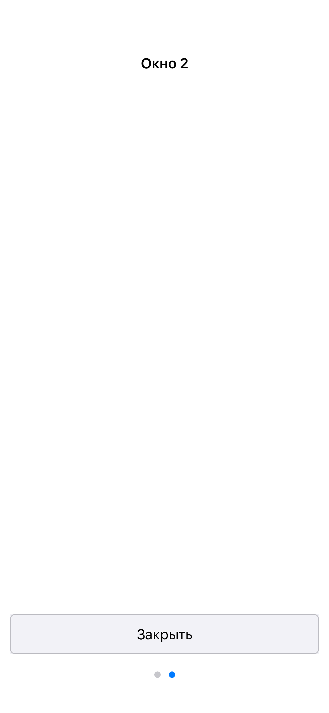

# iOS USER lifecycle and cold restoration — 2026-11-11

The user reported that closing the iOS application lost state. This follow-up
changes only the iOS host, product naming and iOS acceptance; the common model,
USER format, graph schema and other backends are unchanged.

## Diagnosis

The installed product was ordinary Debug (`org.apptraverse.WindowCatalog.ios`).
Its contract is a fresh graph once per process. It saves USER under a unique
Debug-run directory, but deliberately does not load it on a new process launch.
The earlier cold acceptance exercised a separate explicit embedded consumer,
so that PASS did not prove restoration by the Debug product left for the user.

Actual OS delivery was verified before changing the installed application:
launching system Settings through simctl caused the existing product to write
`debug-run-4087377429/user/user.bin` (6,092 bytes). Before that OS transition,
this run had no USER file. Its exact generated supply and USER were copied
together to a local backup. A USER from a Debug graph must not be combined with
another graph's generated supply.

There was also an earlier lifecycle boundary to handle: the host observed
SwiftUI view `scenePhase.background`, while app-switcher deactivation starts
at inactive. The host now owns native UIApplication notifications, including
`willResignActiveNotification`, independently of the SwiftUI view.

Apple recommends preserving data when leaving the active state. A suspended
application generally receives no final termination callback, so waiting for
`applicationWillTerminate` cannot guarantee saving after dismissal.
See [background preparation](https://developer.apple.com/documentation/uikit/preparing-your-ui-to-run-in-the-background)
and [termination callback semantics](https://developer.apple.com/documentation/uikit/uiapplicationdelegate/applicationwillterminate(_:)).

## Resulting behavior

Native deactivation starts ordinary model-session shutdown: drain accepted
commands/publications, save the graph into RAM USER, write one `user.bin`, join
and release the session. A UIKit background task covers that work. Duplicate
notifications do not create a second task/session. Activation waits for an
already-stopping session to join before creating a new runtime over the same
RAM profile. The main queue remains free to acknowledge publications while
shutdown drains. No POSIX signal I/O, per-command checkpoint or mirror save.

The explicit embedded consumer is displayed as **WindowCatalog** and restores
its stable USER on cold startup. Ordinary Debug is displayed separately as
**WindowCatalog Debug**, retaining the canon's fresh-process behavior.

## Executed verification

Intel macOS 13.7.8, MacPorts clang 20.1.8/C++20, Xcode 15.2/Swift 5.9.2,
iPhone 15 Pro, iOS Simulator 17.2 x86_64.

- Incremental frozen-source build: **11/11 steps PASS**, both product bundles
  and both acceptance bundles.
- Existing acceptance: **3/3 processes PASS**, 21 Debug seed, 21 embedded seed,
  5 embedded cold checkpoints. The lifecycle steps now post native
  deactivation/activation notifications instead of calling host methods.
- Additional OS scenario: **2/2 processes PASS**. A fresh embedded seed stops
  its test automation while active, with no USER file. The external runner
  launches Settings through simctl; one nonempty USER appears. The runner
  terminates that background process and starts a separate cold process using
  the same profile. **5/5 cold checkpoints PASS**: graph/locale/holder and active
  identity, native selection, reopening a closed page with its old identity,
  and orderly shutdown. The OS seed does not invoke lifecycle methods or post
  lifecycle notifications itself.
- Swift parse, Python syntax and whitespace checks PASS. Independent review
  found no blocking drain/join or rapid reactivation race in this path.

Evidence: `work/ios-persistence-build.log`, `work/ios-persistence-tests.log`,
`work/ios-persistence-acceptance/20261111-001130`, especially `os-lifecycle/`.
The in-process notification checks and the real OS transition are distinct
parts of that evidence. No new XCUITest touch-input PASS is claimed here.

## Installed product and preserved user state

Installed the updated Debug product with its distinct label and the explicit
embedded consumer as `org.apptraverse.WindowCatalog.ios.loadonly`. The latter
uses the exact 55,209-byte supply from the latest saved Debug run, not an
unrelated newly distilled graph. Its new default Application Support profile
received a byte-identical copy of the user's saved 6,092-byte USER. The original
Debug data and the local paired backup remain intact.

The product restored **Window 2** with three model pages. It was then switched
to Settings, observed writing one USER, terminated and launched cold again.
USER remained byte-identical across that full product cycle:
`eafba518dbb7e4c2835f8d94692d70fca4b7e49b554bb97f7b8375222d85160c`.
The matching supply hash is
`511841524fb510cd790908995522f2dbb055cee317c91526c73cb5bb9a517d6f`.
The persistent product was left running. Evidence:
`work/ios-persistence-install.log`,
`work/ios-persistence-product-roundtrip.log` and its JSON record.

Physical iPhone execution/signing and other-platform native tests were not run
for this iOS-only change. Forced termination without any lifecycle execution
time cannot start new I/O; persistence begins at deactivation in advance.
