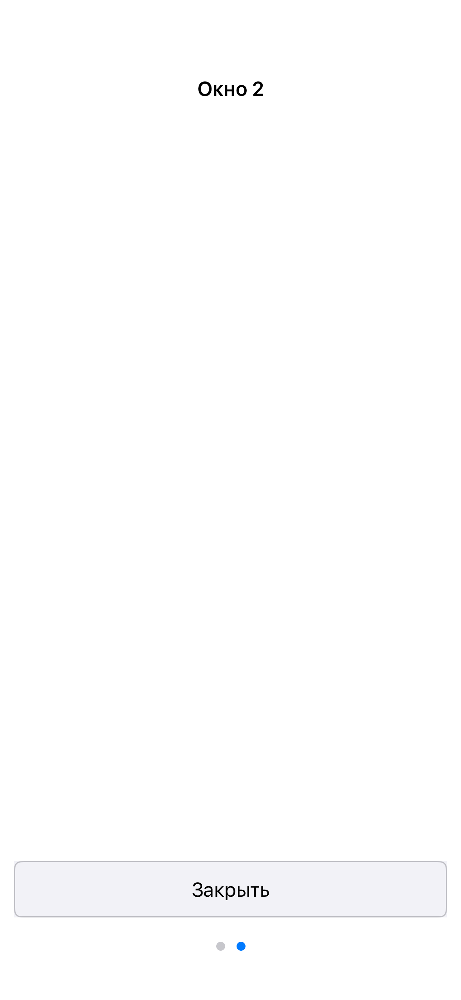

# iOS live USER save without presenter teardown — 2026-11-11

User explicitly requested saving USER at deactivation while retaining the model
and presenters. Baseline: `0c27207`, `feature/cross-platform-user-state`.
This supersedes the iOS session-stop/resume mechanism in the earlier lifecycle
report; that report remains historical evidence of its previous scope.

## Mechanism and canon

The native host observes UIApplication deactivation, background and activation.
The active-to-inactive transition starts a UIKit background task and requests
the existing bridge's `requestBackgroundSave`. The bridge posts the application's
`persist_model(domain)` callback into the continuing model runtime queue, behind
already accepted work. The application uses the same `CatalogProfile::Persist`
helper for this callback and explicit shutdown: ordinary model snapshot into
RAM USER, then `SaveUserStorageFile` to one `user.bin`.

`SavePresentedWindow` saves loaded objects without resetting their links. Closed
and lazy windows are not materialized for the save. The model Domain/root,
runtime, UI session/mirror, presenter objects, view adapters and native window
remain owned by the existing session. Activation does not recreate them.
The loading placeholder is now limited to initial startup or true teardown.
No screenshot overlay masks a teardown.

Inactive followed by background coalesces into one save. A new activation and
deactivation queues a further save after newer accepted commands, including
when an earlier save is still completing. Pending-save counts and status are
transient native lifecycle state. Save status is distinct from model exit.
The background task ends after all pending saves complete. The UI main queue
stays unblocked; explicit shutdown still drains accepted work, persists and
joins before normal presenter teardown.

This follows the live platform-boundary policy already used by Android/Web.
Architecture §8 and rule 12 now explicitly cover the user-authorized iOS
boundary. No common runtime/Core/serializer, model Events, persistent fields,
USER byte format, graph schema or other backend implementation changed.
There is no UI-mirror save, per-gesture file write, additional checkpoint format,
fallback reset, migration or global graph keepalive. Debug remains fresh on a
new process; the explicit embedded consumer restores a matching USER revision.

## Executed checks

Intel macOS 13.7.8; MacPorts clang 20.1.8/C++20; Xcode 15.2/Swift 5.9.2;
iPhone 15 Pro / iOS Simulator 17.2 x86_64.

- Host Debug iOS supply exporter: **65/65 build steps PASS**.
- Both iOS products and both acceptance apps: **18/18 build steps PASS**.
- Native acceptance: **5/5 processes PASS**. Debug seed 23, embedded seed 23,
  initial embedded cold restart 5 checkpoints; real OS seed/resume/second save
  followed by another cold process with 5 cold checkpoints.
- Notification-route tests compare actual bridge, scene, button/list adapter,
  presenter-token and native-window identities before/after save and activation.
  The model is still running, its exit status is nil, and an active scene remains
  present. Rapid lifecycle notifications include navigation accepted immediately
  before save; later USER bytes must change and the same session remains alive.
- The external OS scenario launches system Settings, observes one USER and then
  reactivates the fixture. PID **73632** remains the same. The fixture verifies
  identical live bridge/presenters, accepts further navigation without a disk
  write, and updates expected active/selected state. A second Settings transition
  saves that later command. The process is then terminated; a separate cold
  process checks graph, locale, active/selected state, holder identity, lazy
  closed-page reopening identity and normal shutdown.
- Swift/Python syntax and `git diff --check`: PASS. Independent read-only review
  found no blocking thread, lifetime or canon defect in the changed path.

Evidence: `work/ios-live-exporter-build.log`, `work/ios-live-configure.log`,
`work/ios-live-build.log`, `work/ios-live-tests.log`,
`work/ios-live-acceptance/20261111-124502`, particularly `os-lifecycle/` and
`result-os-resume.json`. Notification injection and actual OS delivery are
separate checks. No new XCTest tap/swipe, physical-device, distribution-signing
or other-platform runtime PASS is claimed for this iOS-only change.

## Manual product deployment

Updated both Debug and embedded products, leaving **WindowCatalog**
(`org.apptraverse.WindowCatalog.ios.loadonly`) running for manual verification.
The 7,103-byte profile from the current revision's Debug run is paired with the
new generated supply; the two independently produced headers are byte-identical
(SHA256 `1c884717301fd3d79155701ed69913448b863d6f412cbfe3728f2dc88b7bc3a4`).
The prior experimental consumer profile and its executable were preserved under
`work/ios-live-before`; no unsupported old-schema migration or silent runtime
reset was added. Deployment records: `work/ios-live-install.log` and
`work/ios-live-installed.json`.

App-switcher presentation is available for the user's requested manual check.
Normal OS suspension preserves the live process's memory; forced termination
without execution time cannot start new I/O. Background-task expiry does not
introduce recovery, retry or another persistence subsystem.
