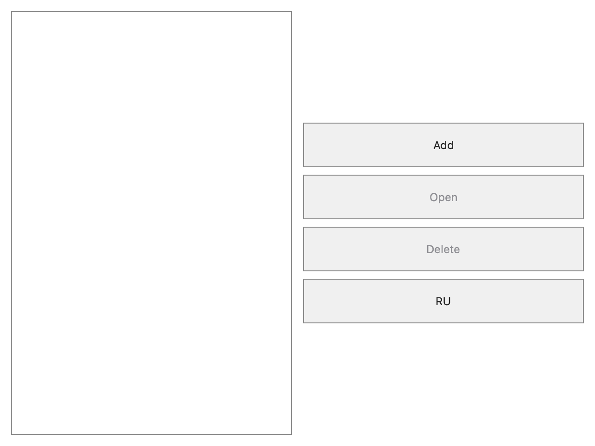
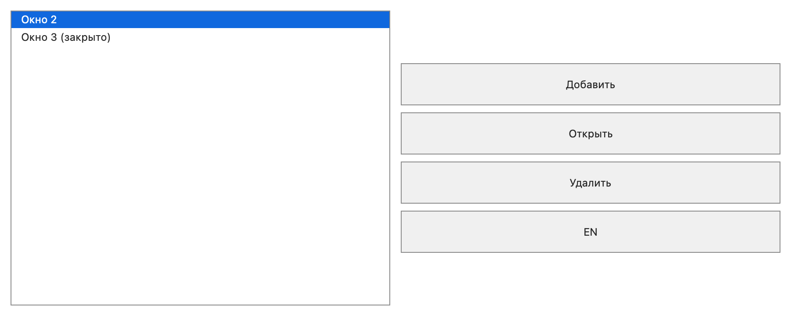

# macOS WindowCatalog — 2026-11-10

Isolated branch `feature/apple-window-catalog`, based on
`feature/domain-hierarchy-cloning` at `b0c808d81b187b3fa890b0a59d25e5a7bf23c66a`.
The user explicitly assigned Apple ports in a separate checkout while the
original branch continues Windows/Linux/Web/Android/headless work. macOS is the
current priority; iPhone behavior is deferred. This report does not replace the
other branch's active queue or historical evidence.

## Result and architecture

Implemented a macOS WindowCatalog application with the shared graph builder,
model session, runtime, proxy, UI mirror, RAM USER and single-file shutdown.
Only two catalog-specific presenters sit over the generic Mac Window/Button/List
backend. No common model/runtime/storage sources were changed.

The SwiftUI content uses the Windows model's list/four-button layout, localized
text, simple rectangular controls and disabled appearance. Independent AppKit
windows provide native title bars, resize/move, Close, Cmd-W and Cmd-Q.
Desktop coordinates are signed, upper-left based, with client sizes. AppKit
placement/workarea and actual frames return to the model as Events. Ordinary
publications do not reapply stale geometry; explicit frame requests do.
Focus and desktop Z-order use logical window identities.

Debug creates a fresh graph and its supply; a separate load-only executable
embeds the supply prepared by that same Debug application's `--distill-only`.
Child Close writes RAM only. Root Close/Quit drain accepted work and write one
`user.bin`; cold load restores the graph without activating closed children.

## Defects found and fixed

- Mac backend registration omitted the transitive UI-control schema anchor.
  The first supply build aborted during historical hydration. The backend now
  anchors the same UI module as Windows/Linux; application startup remains one
  registration entry point.
- Old frame reports bypassed the virtual catalog/main viewport route, omitted
  workarea data and applied geometry on ordinary publications. Corrected native
  observation/request separation and model-owned placement.
- Explicit AppKit application activation was missing from focus of an already
  open child. Native acceptance reproduced the focus timeout before the fix.
- The old pending-close adapter flag could survive a coalesced Close/Open.
  Removed the permanent gate. Native frame/screen commands resolve only a live
  model target when executed; a target already unloaded by Close is a legitimate
  queued lifecycle disappearance and is not reloaded. A deterministic test
  covers both dropping these late commands and applying live commands.
- Shutdown input could reset its stop gate on a second Close; host and bridge
  now retain the stop barrier. Quit captures desktop order through app policy.
- SwiftUI single-selection `Binding<Int?>` requires row tags of `Int`.
  Optional row tags left the actual table unselected despite mirror selection.
  Visual QA prompted a real `NSTableView` assertion: baseline native row -1 vs
  mirror row 0. Integer tags fixed rendering and native selection input.

## Executed evidence

Host: Intel x86_64 macOS **13.7.8**, Xcode Swift **5.9.2**, MacPorts clang
**20.1.8** for C/C++/ObjC++, macOS SDK 14.2, deployment target 13.0. Debug,
no C++ RTTI/exceptions, `AE_NO_DEBUG_LOG=ON`. Dependencies were prepared in an
isolated build cache; subsequent builds were incremental.

**7 common tests PASS**: object clone, Æther domain hierarchy, application
contract headless, nested window frame publication, single-file USER,
historical-base materialization and WindowCatalog headless. Runs: 5/5 in
12.22 s and 2/2 in 10.76 s.

**2 native CTests PASS**, final run **20.09 s**: backend lifecycle 1.74 s;
WindowCatalog acceptance 18.34 s. The acceptance launches Debug fresh,
embedded seed and a separate-process cold restart, with 51 passing checkpoints.
It checks add, real native table selection/rendering, activation/focus,
localization, clone identities, native resize, requested geometry, rapid
Close/Open followed by another Close, Delete, lazy reopening, cold geometry,
selection and desktop order, teardown and one shutdown USER. Seed uses root
Close; cold uses the Quit handler. The test-only C++ helper additionally checks
signed-workarea model centering and late queued geometry after unload.

Final artifact run: `macos-acceptance/20261110-221417-2521be71` beneath the build.
Local logs: `regression-macos.log`, `regression-catalog-macos.log`,
`native-selection-acceptance.log`, `build-native-selection.log` in the enclosing
work directory. The deliverable evidence folder includes the passing logs.

Visual QA inspected actual hosting-view PNGs before and after the selection
fix. Final content captures:

## Scope and remaining work

Native table selection uses actual `NSTableView` input; buttons and activation
use the production SwiftUI adapter action handlers. Geometry uses actual
`NSWindow` methods. This is not a synthesized mouse/interactive-drag acceptance.
PNG capture covers hosting content, not system title bars.

External Computer Use was **unavailable**: the installed
`SkyComputerUseService` declares macOS **14.4** minimum in both Info.plist and
Mach-O, above this host's 13.7.8. No permission changes or OS upgrade were made.
Own-window test capture works without that service.

Windows/Linux/Web/Android native regression and iOS are **NOT RUN** here.
Common production sources remain unchanged. Source inspection found the same
missing transitive UI anchor and Optional list-tag pattern in the old iOS
backend; they remain deferred to the iPhone task, with no iOS readiness claim.
The common direct proxy route for native geometry in other backends was not
changed or audited beyond this port's corresponding boundary. Release/MinSizeRel,
universal binaries and distribution signing/notarization were not requested.

Build/launch instructions: [macOS README](../../examples/surfaces_demo/macos/README.md).
