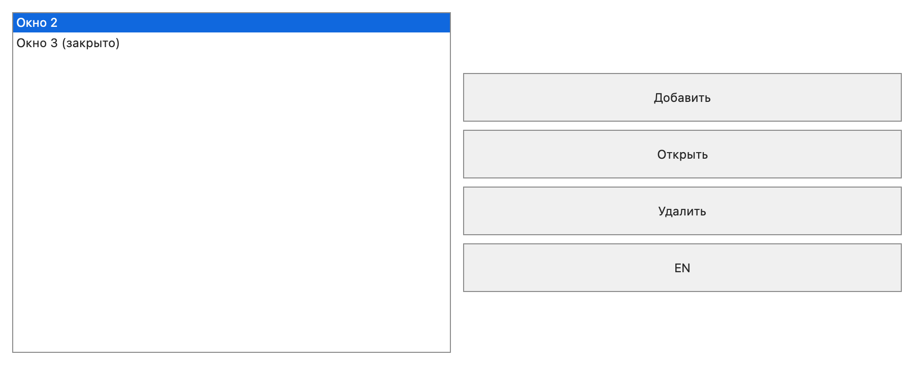

# macOS WindowCatalog native mouse input — 2026-11-10

The user reported intermittent window-list clicks after the initial Apple port.
The earlier native-table selection test changed `NSTableView` selection
programmatically; it did not exercise the actual mouse/gesture route.

## Reproduction and fix

A regression now enqueues actual AppKit `NSEvent` mouse-down/up pairs through
the window's normal event routing, clicking the trailing whitespace of rows.
The baseline single click selected a row, but double-click never focused the
existing child and timed out. The SwiftUI row double-tap gesture competed with
the underlying native list's mouse processing.

The list is now one native `NSTableView` inside an `NSViewRepresentable`.
AppKit selection delegation and `doubleAction` are the only input route;
there are no SwiftUI row gestures. Native selection is transient, while the
model publication remains the confirmed selection. Layout-only updates do not
reapply an unchanged published selection and undo a just-received native click.
A displayed row identity is resolved against the current mirror before the
intent is sent, so a removed/reordered row cannot redirect an old click to
another object. Native callbacks are disconnected before presenter release.

Cells use Auto Layout to retain visible text after reload/resize. The test
checks native text contents and nonempty visible text geometry, not only
adapter state. The list accepts the first click when its window is inactive.
Common model/runtime and serialized schemas were not changed for this input fix.

## Executed evidence

Intel macOS 13.7.8, MacPorts clang 20.1.8, Xcode Swift 5.9.2, Debug.
Final Mac suite: **3/3 PASS, 83.74 s**: backend lifecycle 4.21 s,
WindowCatalog headless 36.92 s, native acceptance 42.57 s.
Six additional common clone/domain/history/storage/publication tests:
**6/6 PASS, 35.19 s**. Together the selected checks are **9/9 PASS**.

Native acceptance runs fresh Debug, embedded seed and a separate cold process.
It covers real whitespace single/double-click, cold native selection, locale,
identities, resize/model frame requests, Close/Open/Delete, rapid Close/Open,
Z-order, RAM-only child Close, single-file USER and native teardown. The
headless suite includes the separately added mobile viewport/DPI regression.

Logs: `work/apple-final-host-tests.log`, `work/apple-common-regression.log`.
Artifact run: `build-macos/macos-acceptance/20261110-230259-45547962`.
The preceding baseline failure is retained in `work/mac-click-baseline.log`.
An earlier disposable cold test stalled in host AppKit/RunningBoard startup;
a fresh complete final suite passed. No host daemon/security settings changed.

The screenshot captures hosting content, without system title bars. These
checks do not establish native behavior on Windows/Linux/Web/Android or iOS.

## Updated MinSizeRel

The fixed native host also built in MinSizeRel. The executable is
**1,199,752 bytes** (about 1.144 MiB). Its embedded 52,803-byte supply header is
byte-identical to the earlier Debug-prepared supply, so the user's existing
profile remains paired with the same supply. Symbol/dependency inspection found
no builders, distillation, C++ RTTI/throw machinery or MacPorts runtime libraries.

The output application was replaced after checking for an existing instance
through the native orderly-quit helper. No instance required termination.
It was launched with the existing `work/minsize-profile`; PID 65002 remained
alive for over a minute and the saved 6,811-byte USER remained byte-identical.
The preceding executable and USER were backed up locally. The acceptance suite
above was run in Debug/explicit embedded configurations; this MinSizeRel step
is build, binary inspection and launch evidence, not a second full input suite.
